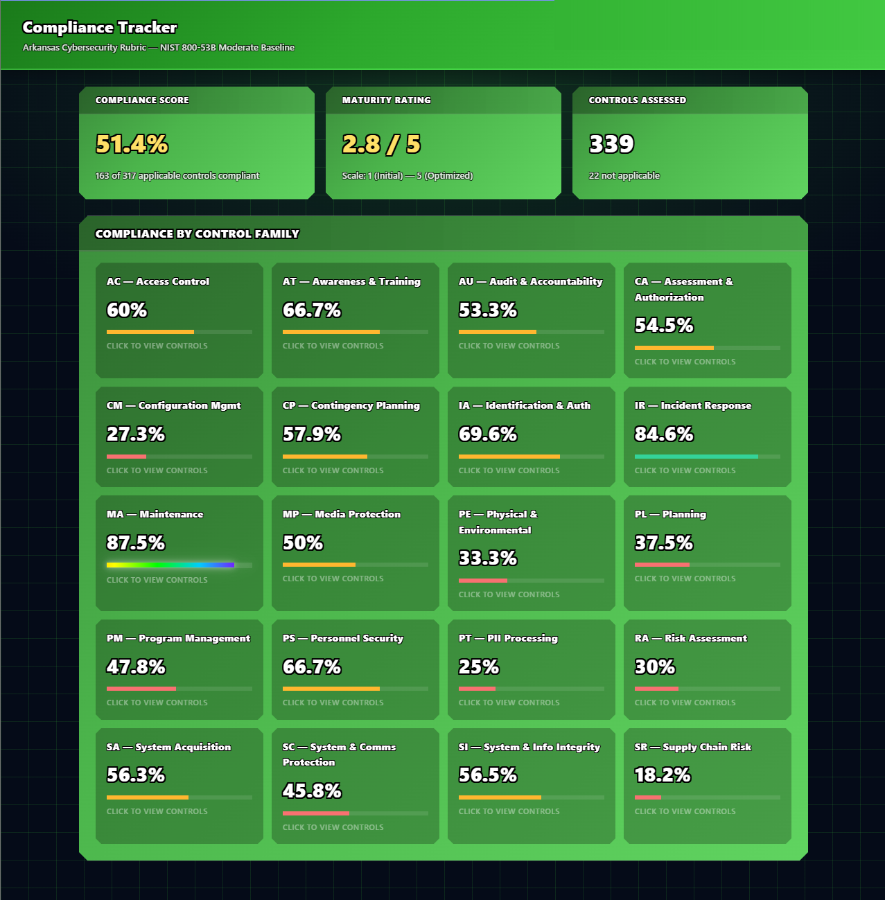
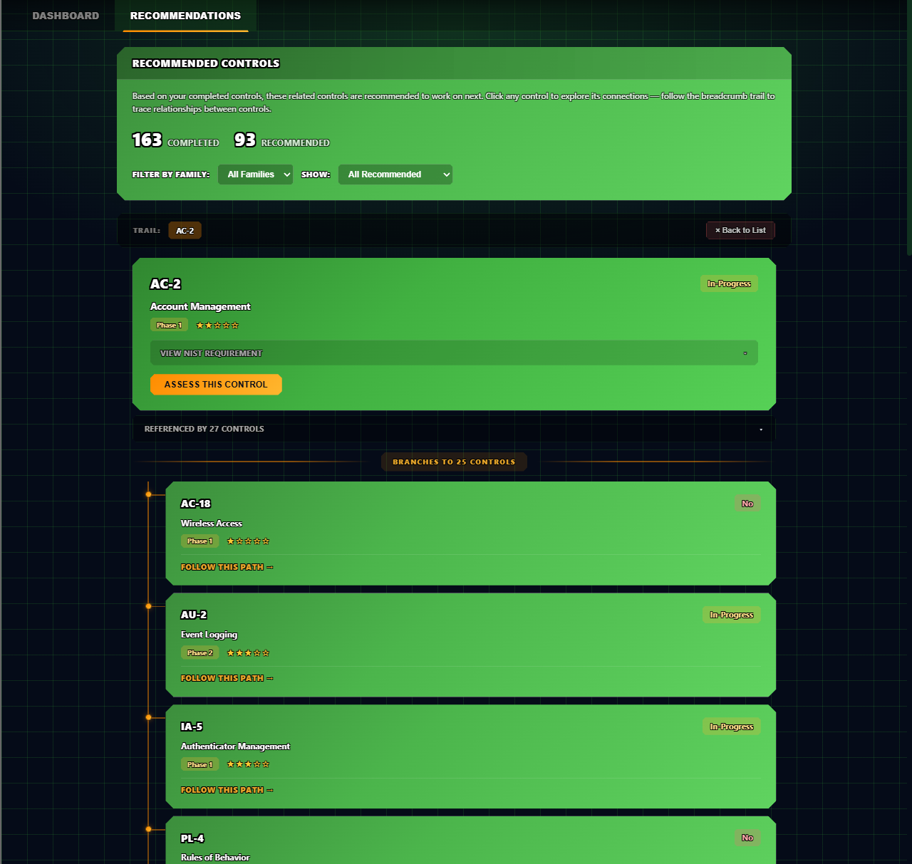

# Compliance Tracker — Arkansas Cybersecurity Rubric

A web-based compliance tracking and audit management system built for organizations following the **Arkansas Cybersecurity Rubric (ACT 504)** based on the **NIST 800-53B Moderate Baseline**.





## Live Demo

**[https://compliance-tracker.onrender.com](https://compliance-tracker.onrender.com)**

> Demo credentials: `noble@archfordcoop.com` / `password`
>
> Note: The free-tier Render instance spins down after inactivity. The first load may take 30–60 seconds while it wakes up.

## Overview

The Compliance Tracker digitizes the process of assessing and tracking cybersecurity compliance across all 20 NIST 800-53 control families. Instead of manually managing spreadsheets, organizations can use this tool to:

- **Track compliance status** across 339 controls with Yes / No / In-Progress / Not-Applicable answers
- **Rate maturity levels** on a 1–5 scale (Initial → Optimized) for each control
- **View compliance scores** at a glance with an overall percentage and per-family breakdown
- **Drill into control families** by clicking any family card to see individual controls
- **Explore recommended controls** through an interactive decision tree that maps relationships between NIST controls — follow branching paths from one control to the next
- **Navigate control connections** with a breadcrumb trail that tracks your exploration path and lets you jump back to any point
- **Import existing rubric data** from an Arkansas Cybersecurity Rubric Excel spreadsheet — drag-and-drop upload with per-family import results
- **Review full NIST requirements** with expandable descriptions pulled from the official standard
- **Document evidence** and notes for each control assessment

## Tech Stack

| Layer | Technology |
|-------|-----------|
| Frontend | HTML, CSS, JavaScript (vanilla) |
| Backend | Node.js, Express.js |
| Database | PostgreSQL |
| Authentication | JWT (JSON Web Tokens) |
| Hosting | Render (Web Service + PostgreSQL) |
| CI/CD | GitHub Actions |

## Architecture

```
┌─────────────────────────────────────────────────────┐
│                   Browser (Client)                    │
│   index.html  +  main.js  +  styles.css              │
└──────────────────────┬──────────────────────────────┘
                       │ HTTPS
┌──────────────────────▼──────────────────────────────┐
│              Render Web Service                       │
│  ┌─────────────────────────────────────────────┐     │
│  │  Express.js (app.js)                        │     │
│  │  ├── /api/auth      → JWT login/register    │     │
│  │  ├── /api/controls  → NIST control catalog  │     │
│  │  ├── /api/compliance→ Compliance CRUD       │     │
│  │  ├── /api/dashboard → Score aggregation     │     │
│  │  ├── /api/recommendations → Decision tree   │     │
│  │  ├── /api/import    → Excel rubric upload   │     │
│  │  └── static files   → Frontend assets       │     │
│  └──────────────────────┬──────────────────────┘     │
└─────────────────────────┼────────────────────────────┘
                          │ pg (TCP)
┌─────────────────────────▼────────────────────────────┐
│           Render PostgreSQL (Free Tier)               │
│   users │ controls │ compliance_status │ related_...  │
└──────────────────────────────────────────────────────┘
```

## CI/CD Pipeline

Every push to `main` triggers the GitHub Actions pipeline (`.github/workflows/ci.yml`):

```
Push to main
    │
    ▼
┌──────────────┐     ┌──────────────┐
│  Lint & Test │────▶│   Deploy     │
│  (Node 18)   │     │  to Render   │
│  npm ci      │     │  (auto)      │
│  npm test    │     └──────────────┘
└──────────────┘
```

1. **Lint** — runs ESLint across `src/`
2. **Test** — runs Jest with coverage reporting
3. **Deploy** — Render auto-deploys from the `main` branch (connected via GitHub integration). An optional deploy hook can also be configured.

Pull requests run lint + test but do not deploy.

## Getting Started (Local Development)

### Prerequisites

- Node.js (v18+)
- PostgreSQL (v14+)

### Setup

1. Clone the repository:
   ```bash
   git clone https://github.com/NobleWebb/CSCI-6397-Capstone-Project-Proposal.git
   cd CSCI-6397-Capstone-Project-Proposal/compliance-tracker/backend
   ```

2. Install dependencies:
   ```bash
   npm install
   ```

3. Create your environment file:
   ```bash
   cp .env.example .env
   ```
   Edit `.env` with your local PostgreSQL credentials.

4. Set up and seed the database:
   ```bash
   psql -U postgres -c "CREATE DATABASE compliance_tracker;"
   npm run seed
   ```
   This creates all tables, inserts the demo user, loads 339 NIST controls, their descriptions, and the related-controls graph.

5. Start the development server:
   ```bash
   npm run dev
   ```

6. Open **http://localhost:3000** in your browser.
   - Login: `noble@archfordcoop.com` / `password`

### Running Tests

```bash
npm test              # Run tests with coverage
npm run test:watch    # Watch mode
```

## Deploying to Render

### One-Click Deploy

[](https://render.com/deploy?repo=https://github.com/NobleWebb/CSCI-6397-Capstone-Project-Proposal)

This uses the `render.yaml` blueprint to create both the web service and PostgreSQL database automatically.

### Manual Deploy

1. Create a **PostgreSQL** database on Render (free tier).
2. Create a **Web Service** connected to this GitHub repo.
   - **Root Directory:** `compliance-tracker/backend`
   - **Build Command:** `npm install && node src/database/seed.js`
   - **Start Command:** `node src/server.js`
3. Set environment variables:
   - `DATABASE_URL` — from the Render PostgreSQL dashboard (Internal Database URL)
   - `JWT_SECRET` — any random string
   - `JWT_EXPIRE` — `24h`
   - `NODE_ENV` — `production`

## Project Structure

```
CSCI-6397-Capstone-Project-Proposal/
├── .github/workflows/
│   └── ci.yml                  # CI/CD pipeline
├── render.yaml                 # Render deployment blueprint
├── compliance-tracker/
│   ├── backend/
│   │   ├── public/             # Frontend (HTML, CSS, JS)
│   │   │   ├── index.html      # Main app (Dashboard, Recommendations, Import)
│   │   │   ├── main.js         # Client-side logic
│   │   │   └── styles.css      # Styling
│   │   ├── src/
│   │   │   ├── database/       # DB connection, schema, seed script
│   │   │   ├── middleware/      # JWT auth middleware
│   │   │   ├── routes/          # API endpoints (auth, compliance, import, etc.)
│   │   │   ├── services/        # Scoring logic
│   │   │   └── utils/           # Input validators
│   │   ├── tests/               # Jest test suite
│   │   ├── .env.example         # Environment template
│   │   └── package.json
│   └── docs/                    # Screenshots & documentation
└── README.md
```

## API Endpoints

| Method | Endpoint | Description |
|--------|----------|-------------|
| POST | `/api/auth/login` | Authenticate and receive JWT |
| GET | `/api/compliance` | Get all compliance records for the logged-in user |
| GET | `/api/compliance/score` | Get overall and per-family compliance scores |
| PUT | `/api/compliance/:controlId` | Update a control's answer, rating, and evidence |
| GET | `/api/recommendations` | Get recommended controls based on completed assessments |
| GET | `/api/recommendations/connections/:controlId` | Get a control's connections (leads to / referenced by) |
| POST | `/api/import` | Upload an Arkansas Cybersecurity Rubric Excel file and import compliance data |

## Security Features

- JWT authentication on all API endpoints
- Input validation using express-validator
- Helmet.js for HTTP security headers
- Rate limiting to prevent brute force attacks
- Parameterized queries to prevent SQL injection
- CORS configured for frontend origin
- Bcrypt password hashing (10 salt rounds)

## Course

**CSCI 6397 — Software Engineering and AI Capstone**
