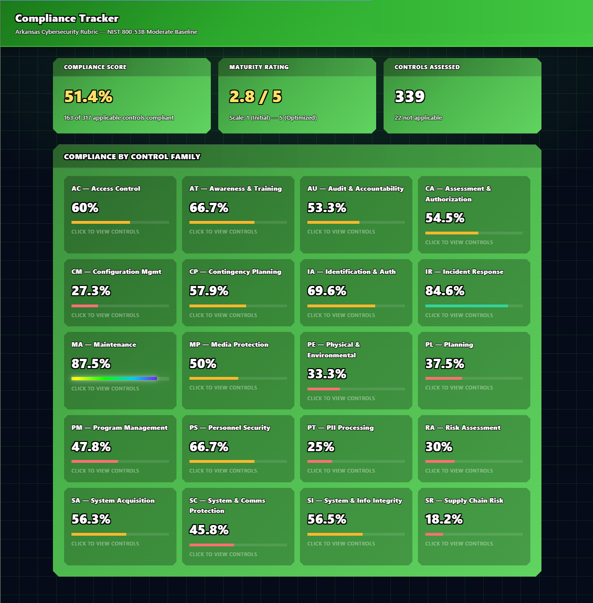

# Compliance Tracker — Arkansas Cybersecurity Rubric

A web-based compliance tracking and audit management system built for organizations following the **Arkansas Cybersecurity Rubric (ACT 504)** based on the **NIST 800-53B Moderate Baseline**.



## Overview

The Compliance Tracker digitizes the process of assessing and tracking cybersecurity compliance across all 20 NIST 800-53 control families. Instead of manually managing spreadsheets, organizations can use this tool to:

- **Track compliance status** across 339 controls with Yes / No / In-Progress / Not-Applicable answers
- **Rate maturity levels** on a 1–5 scale (Initial → Optimized) for each control
- **View compliance scores** at a glance with an overall percentage and per-family breakdown
- **Drill into control families** by clicking any family card to see individual controls
- **Review full NIST requirements** with expandable descriptions pulled from the official standard
- **Document evidence** and notes for each control assessment

## Tech Stack

- **Frontend:** HTML, CSS, JavaScript (vanilla)
- **Backend:** Node.js, Express.js
- **Database:** PostgreSQL
- **Authentication:** JWT-based login

## Getting Started

### Prerequisites

- Node.js (v18+)
- PostgreSQL (v14+)

### Setup

1. Clone the repository:
   ```bash
   git clone https://github.com/NobleWebb/CSCI-6397-Capstone-Project-Proposal.git
   cd CSCI-6397-Capstone-Project-Proposal/compliance-tracker/backend
   ```

2. Install dependencies:
   ```bash
   npm install
   ```

3. Set up the database:
   ```bash
   psql -U postgres -c "CREATE DATABASE compliance_tracker;"
   psql -U postgres -d compliance_tracker -f src/database/schema.sql
   ```

4. (Optional) Populate full NIST standard descriptions:
   ```bash
   psql -U postgres -d compliance_tracker -f update_nist_descriptions.sql
   ```

5. Start the server:
   ```bash
   npm start
   ```

6. Open **http://localhost:3000** in your browser.

## Project Structure

```
compliance-tracker/
├── backend/
│   ├── public/            # Frontend (HTML, CSS, JS)
│   ├── src/
│   │   ├── database/      # DB connection & schema
│   │   ├── middleware/     # JWT auth middleware
│   │   ├── routes/         # API endpoints
│   │   ├── services/       # Scoring logic
│   │   └── utils/          # Validators
│   ├── server.js           # Express entry point
│   └── package.json
└── docs/                   # Screenshots & documentation
```

## API Endpoints

| Method | Endpoint | Description |
|--------|----------|-------------|
| POST | `/api/auth/login` | Authenticate and receive JWT |
| GET | `/api/compliance` | Get all compliance records for the logged-in user |
| GET | `/api/compliance/score` | Get overall and per-family compliance scores |
| PUT | `/api/compliance/:controlId` | Update a control's answer, rating, and evidence |

## Course

**CSCI 6397 — Software Engineering and AI Capstone**
